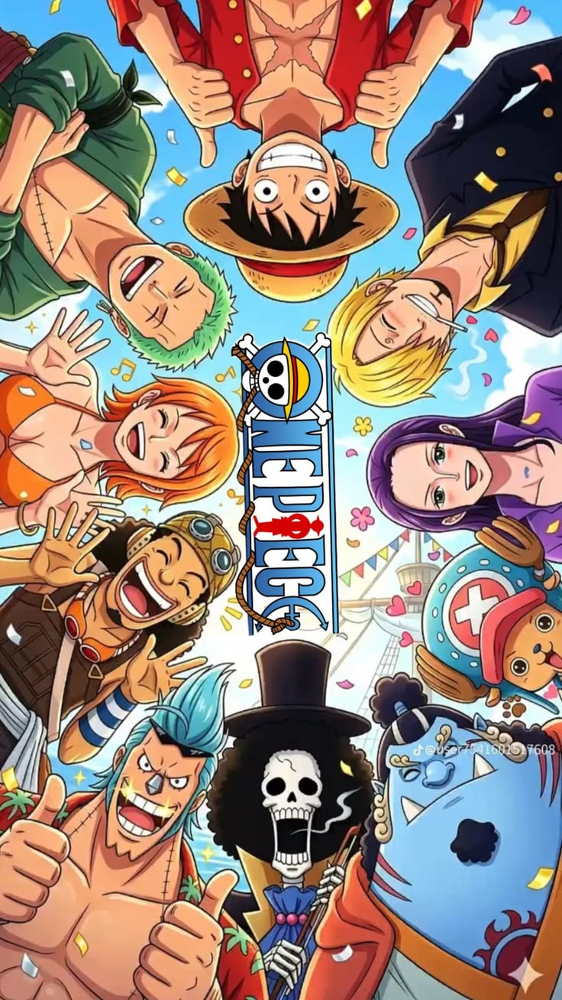

# ONE PIECE 

## About One Piece

**One Piece** is a popular Japanese anime and manga created by *Eiichiro Oda*. It follows the adventure of Monkey D. Luffy and his crew as they travel across the sea in search of the legendary treasure called the One Piece.

## Main Character

**Monkey D. Luffy** is the main character of the story. He dreams of becoming the King of the Pirates.

## My Favorite Characters

- Monkey D. Luffy
- Roronoa Zoro
- Nami
- Sanji
- Usopp
- Tony Tony Chopper

## Why I Like One Piece

I like One Piece because it has an interesting story, funny moments, exciting adventures, and meaningful friendships. It also teaches lessons about never giving up and following your dreams.

> "A story about dreams, friendship, and adventure."

## My Favorite Things About the Series

1. The adventures of the Straw Hat Pirates.
2. The exciting battles.
3. The unique characters.
4. The story and its mysteries.

## Final Thoughts

*One Piece is one of my favorite anime series because every adventure makes the story more interesting. I enjoy watching Luffy and his crew travel together and achieve their dreams.*

**Favorite Anime:** One Piece

**Creator:** Eiichiro Oda
